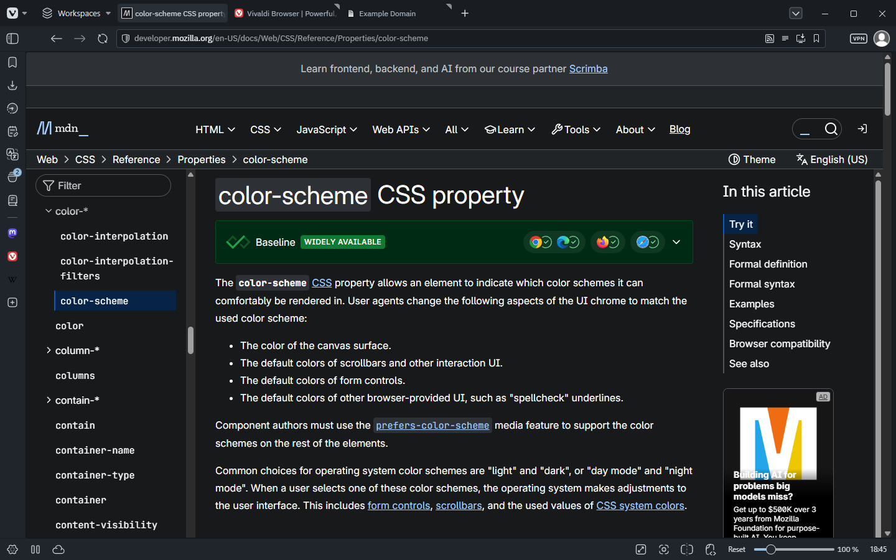
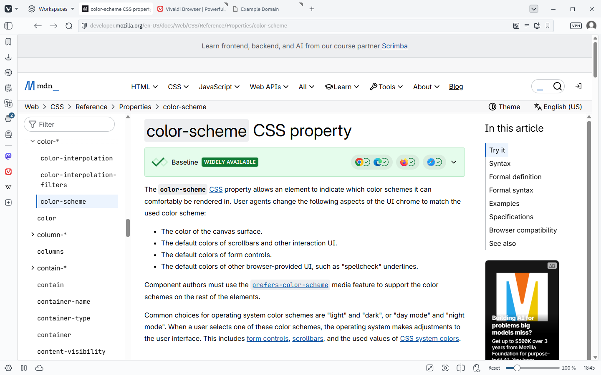
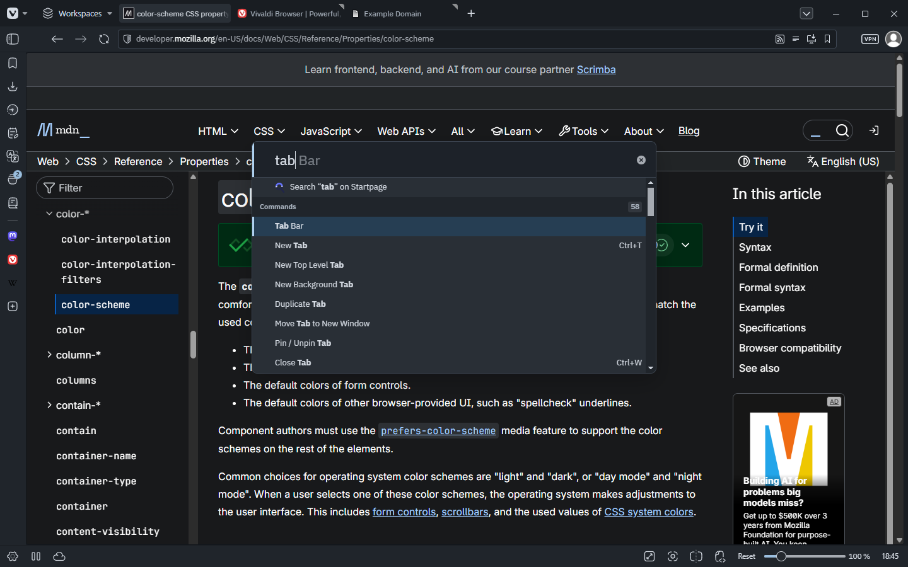
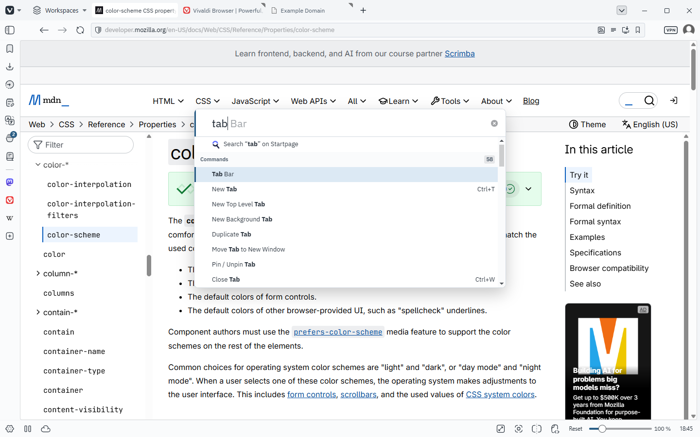

# Flatcap for Vivaldi

  

  

  

Flatcap Slate (dark) above, Flatcap Daylight (light) below.

<table>
  <tr>
    <td width="50%"></td>
    <td width="50%"></td>
  </tr>
  <tr>
    <td align="center">Slate</td>
    <td align="center">Daylight</td>
  </tr>
</table>

**Flatcap for Vivaldi** brings the Flatcap visual system to your browser: quiet graphite (or soft light) surfaces, one mineral-blue accent, IBM Plex Sans for the interface. Every color comes from the Flatcap 2.0 core.

It has two parts. **Flatcap Slate** (dark) and **Flatcap Daylight** (light) are native Vivaldi themes you import from a ZIP file. On top of them, an optional set of CSS files, which you turn on by hand, restyles parts of the browser interface the theme editor cannot reach: the address field, the Quick Commands popup, tabs, downloads, extensions. There is no installer and no script: you copy files and choose a folder in Vivaldi's settings.

> The interface organizes. Content takes the foreground. Color informs.

*Flatcap for Vivaldi is an independent project. It is not affiliated with, endorsed by or supported by Vivaldi Technologies.*

## Install

Everything here was inspected and tried on **Vivaldi 8.3.4191.44 (Windows)** only. Vivaldi's help says the theme ZIP import exists since Vivaldi 5.0; that was **not** tested on any version before 8.3, and the CSS needs a **desktop Vivaldi**. See *Compatibility* for what was and was not tested.

### 1. The themes

1. Download [`Flatcap-Slate.zip`](https://github.com/cheycron/flatcap-vivaldi/raw/main/themes/Flatcap-Slate.zip) and/or [`Flatcap-Daylight.zip`](https://github.com/cheycron/flatcap-vivaldi/raw/main/themes/Flatcap-Daylight.zip). Do not unzip them.
2. In Vivaldi open **Settings → Themes**. In the **Library**, click **Open Theme** (below your themes) and pick the ZIP.
3. Vivaldi shows a live preview and a small dialog in the middle of the window. Click **Install** to keep the theme (**Cancel** discards it).
4. Select **Flatcap Slate** or **Flatcap Daylight** in the Library.

<!-- TODO: add the themes.vivaldi.net link here once the themes are published there. -->

### 2. The CSS files (optional)

The CSS files are Vivaldi's *Custom UI Modifications*: unofficial, and a new Vivaldi version can break them. Step 1 is done once; step 4 is where you choose what to load.

1. Open `vivaldi://experiments` in the address bar and turn on **Allow CSS modifications** (the address opens Vivaldi's `chrome://flags/` page; the flag is `#vivaldi-css-mods`). Restart Vivaldi when it asks.
2. Make a folder for the files somewhere outside Vivaldi's installation folder (for example `Documents/Vivaldi-css`).
3. Copy `css/flatcap-ui.css` into it. It is the base: the other files use the tokens it defines.
4. Copy the optional files you want from [`css/`](https://github.com/cheycron/flatcap-vivaldi/tree/main/css) into the same folder (see the table in *Use it*). Put the files directly in the folder, not in subfolders.
5. Open **Settings → Appearance → Custom UI Modifications** and choose that folder.
6. Restart Vivaldi. The folder is only read at start-up: in the live QA a folder chosen while Vivaldi was running had no effect until the restart.

Load each file once. The CSS only applies while **Flatcap Slate** or **Flatcap Daylight** is the active theme (see *Use it*).

## Use it

<!-- build:themes -->
| File | Theme | Mode | Accent |
| :--- | :--- | :--- | :--- |
| `themes/Flatcap-Slate.zip` | Flatcap Slate | dark | `#9BBFDF` |
| `themes/Flatcap-Daylight.zip` | Flatcap Daylight | light | `#285D85` |
<!-- /build:themes -->

- **Slate** and **Daylight** are two separate themes. Pick one in *Settings → Themes*. If you use Vivaldi's theme scheduler, schedule these two. A new profile has the schedule set to **Operating System**, which picks the theme for the current light or dark mode and overrides a manual choice; set the schedule to **No Schedule** to pick a theme yourself, or assign the two Flatcap themes to the light and dark slots.
- The CSS files are scoped to the Flatcap themes by theme id (the class `theme-id-<id>` that Vivaldi puts on `#browser`). With any other theme active, they should do nothing, so choosing another theme is also the quickest way to turn all the Flatcap CSS off. This relies on Vivaldi keeping the `id` of the ZIP when you import it. That was checked on a real import in Vivaldi 8.3.4191.44: both ids are kept and the CSS tokens resolve under each theme and stay empty under Vivaldi's built-in themes. If the layers have no effect under the imported theme, see the [QA report](https://github.com/cheycron/flatcap-vivaldi/blob/main/docs/qa-report.md).
- `flatcap-ui.css` is the base. Every other file needs it in the same folder, and none needs any other file. Load only what you like. The order in which Vivaldi reads the files does not matter: `build.py --check` fails if two files fight over the same element and property at equal specificity, and the layers that restyle something the base also styles (`flatcap-url-subtle.css`, `flatcap-extensions-list.css`) win by specificity, not by file order. That is a static check; load order was not varied in a live Vivaldi.

<!-- build:layers -->
| File | What it does | Needs `flatcap-ui.css` | License |
| :--- | :--- | :--- | :--- |
| `css/flatcap-ui.css` | **Base: tokens and core surfaces.** Defines the Flatcap tokens (`--fc-*`) for each theme, then paints the toolbars, bookmark bar, panels and status bar, the address and search fields, the active tab and toolbar button hover, adds a 2px focus ring and the text-selection colors, turns off font ligatures in the address field, and follows `prefers-contrast: more`. Generated by `scripts/build.py`. | (it is the base) | MIT |
| `css/flatcap-quick-commands.css` | **Quick Commands (F2).** Quick Commands popup: raised surface, up to 640px wide, 22px search input, a distinct selected row with an inset bar, URL and shortcut hierarchy, the core overlay shadow. Text is 13px or larger. Row heights and positions are not touched. | yes | MIT |
| `css/flatcap-quick-commands-motion.css` | **Quick Commands entry motion.** Replaces the native Quick Commands entry with a 140ms fade and 4px rise. The list resizes immediately while you type. Off under reduced motion. | yes | MIT |
| `css/flatcap-motion.css` | **Button feedback.** 120ms background-color feedback on toolbar and bookmark-bar buttons. Press and keyboard focus are immediate. Off under reduced motion. | yes | MIT |
| `css/flatcap-surfaces-motion.css` | **Popup, panel and tab timing.** Retimes Vivaldi's own popup entry (140ms transform, 120ms opacity) and exit (100ms fade), the overlay-panel width transition (140ms, off while you drag the panel edge) and the hover feedback of inactive tabs (120ms). Off under reduced motion. | yes | MIT |
| `css/flatcap-tabs-minimal.css` | **Minimal tabs.** Inactive tabs lose their background and border (secondary text color); hover uses the hover surface; the active tab is a raised surface. Tab size, icons, stacks, marked tabs, drop targets and accordions are left alone. | yes | MIT |
| `css/flatcap-url-subtle.css` | **Subtle address field border.** Draws the address field border in the quiet `border.subtle` color at rest and in `border.control` on hover. Keyboard focus keeps the base's 2px focus ring. **Documented accessibility exception:** at rest the border is below the 3:1 outline target (see Accessibility). | yes | MIT |
| `css/flatcap-audio-quiet.css` | **Quiet tab audio indicator.** Keeps Vivaldi's native audio icon and states but removes the hover movement, rounds it and gives it a hover surface and a focus ring. | yes | MIT |
| `css/flatcap-downloads.css` | **Downloads panel and popup.** Flatcap surface for the downloads panel and popup, readable file size, accent progress bar on a subtle track, a divider above the editor. Row sizes, warnings, controls and the unknown-size progress are left alone. | yes | MIT |
| `css/flatcap-extensions-list.css` | **Extensions dropdown as a list.** When extensions live in the dropdown, shows them as a 280px vertical list with the extension name as a visible label. Pinned toolbar icons and extension popups are not touched. GPL-3.0 (see Third-party code). | yes | GPL-3.0 |
| `css/flatcap-extensions-inline.css` | **Expanded extensions group.** When you expand the extensions group in the toolbar, gives it a raised surface, a subtle inset border and rounded corners, and fades the icons in over 140ms. No width animation. Off under reduced motion. | yes | MIT |
<!-- /build:layers -->

**Turn a file off:** move it out of the folder, or rename it (for example `flatcap-motion.css.disabled`), then restart Vivaldi.

**Turn everything off:** in *Settings → Appearance → Custom UI Modifications* remove the folder, or turn the experiment off in `vivaldi://experiments`; then restart. Your bookmarks, tabs and settings are never touched, because the CSS only changes how the interface looks. Removing a theme is done in *Settings → Themes*.

**Example, not a layer:** [`examples/bookmark-bar-inline.css`](https://github.com/cheycron/flatcap-vivaldi/blob/main/examples/bookmark-bar-inline.css) moves the bookmark bar onto the address bar row with icon-only folders. It depends on the titles of *your* bookmark folders, so it must be adapted before use; the instructions are in the file. **It is not scoped by theme id**: unlike every file in `css/`, it applies under any Vivaldi theme once you load it (`build.py --check` exempts `examples/` from the scope check and instead requires the file to say so). It was not tested in Vivaldi in this form.

### If the CSS seems to do nothing

1. Is **Flatcap Slate** or **Flatcap Daylight** the active theme? The files do nothing under any other theme.
2. Is **Allow CSS modifications** on in `vivaldi://experiments`, and did you restart after choosing the folder?
3. Is `flatcap-ui.css` in the same folder? The other files depend on it.
4. Are the files directly in the folder (not in a subfolder) and named without spaces?
5. Otherwise, open an issue with your Vivaldi version.

## Fonts

<!-- build:fonts -->
| Use | Stack (exact) |
| :--- | :--- |
| Browser interface (`--fc-font-ui`, set on `#browser`) | `"IBM Plex Sans", "Segoe UI", system-ui, sans-serif` |

The CSS does not install fonts. Without IBM Plex Sans on the device, the stack falls back to Segoe UI, then the system UI font. The themes themselves carry no font: fonts are set by `flatcap-ui.css` and, if you also set one in *Settings → Appearance*, Vivaldi's own font setting applies to web content only.
<!-- /build:fonts -->

See the [Flatcap typography guide](https://github.com/cheycron/flatcap-theme/blob/main/docs/typography.md).

## Accessibility

This section says what is measured and what is only intended. Nothing here is a claim of WCAG conformance, and no assistive technology was used.

**Measured (static, on the token values, not on a rendered screen).** The colors are the Flatcap 2.0 core. `python3 scripts/build.py --check` computes WCAG 2.x contrast for the pairs the CSS combines (text on each surface, selected and hovered rows, the accent with its text, the focus ring on each surface, the address field border, the download progress bar) against the targets of the [Flatcap core](https://github.com/cheycron/flatcap-theme): 7:1 for primary text, 5:1 for informative text, 3:1 for functional outlines and focus, 4.5:1 for text on fills. It fails if a pair misses its target, **except** the explicit exception below.

**Written into the CSS (read from the rules, not verified live).**

- Focus: the base draws a 2px ring in `focus.ring` on `button`, `input`, `select`, `textarea` and `[tabindex]` elements, and on the address field as a whole while it holds focus (`:focus-within`, an inset ring, so it also shows after a click). Vivaldi controls that are none of those, or that Vivaldi styles with a more specific selector, may not show the ring; this was not checked control by control.
- Forced colors: the layers' colors sit inside `forced-colors: none` (or `not (forced-colors: active)`) blocks, so the system palette is left alone. Not tested on a Windows high-contrast theme.
- Reduced motion: every transition and animation in the layers is inside `prefers-reduced-motion: no-preference`, or switched off in a `prefers-reduced-motion: reduce` block. Not tested with the operating system setting on. Vivaldi's own animations that no Flatcap file touches are not covered.
- Increased contrast: the base switches `text.primary`, `text.secondary`, `text.muted` and `border.control` to the core's `contrast.*` colors under `prefers-contrast: more`. Not tested.
- Text size: no layer sets text smaller than 13px (the core's smallest size, `font.size.meta`); `build.py --check` enforces it. Vivaldi's own text sizes elsewhere are not changed by Flatcap.
- Nothing uses `transition: all`, and no layer transitions or animates a layout property (one native transition is only retimed, see below).

**Explicit exception, intentional and accepted by the owner: `flatcap-url-subtle.css` is below the 3:1 outline target.** It draws the address field border in the quiet `border.subtle` color at rest (1.3:1 to 1.8:1 against the field fill and the bar). No core border token reaches 3:1 except `border.control`, which is what the base already uses (4:1 or more), so making this layer comply would make it do nothing. The field stays recognizable by position, its text and the focus ring, but its border alone is faint, which is below WCAG 2.x 1.4.11 for a component boundary. The visible keyboard focus ring of the base is kept. The layer is optional and off unless you load it; leave it out if you need a clear field boundary.

Other limits:

- The numbers are token-level. They do not prove how every Vivaldi screen renders. Web page content, Vivaldi's own icons, pages such as Settings and any Vivaldi surface the CSS does not name keep Vivaldi's colors.
- One layer retimes a native transition of Vivaldi (the overlay panel width, in `flatcap-surfaces-motion.css`); it is not applied while you drag the panel edge, and it is off under *reduce motion*.

Every mapping is in [docs/mapping.md](https://github.com/cheycron/flatcap-vivaldi/blob/main/docs/mapping.md); the measured ratios, the static checks and what was tested live are in the [QA report](https://github.com/cheycron/flatcap-vivaldi/blob/main/docs/qa-report.md).

## Compatibility

- Developed against **Vivaldi 8.3.4191.44 on Windows**. The selectors were inspected in that build. Nothing else was tested, so nothing else is promised.
- **Checked live (Vivaldi 8.3.4191.44, Windows, a throw-away profile):** importing both ZIPs and the update on a second import, the kept theme ids, the base layer's colors in both themes, no tokens under built-in themes, all 11 CSS files loading, and the Quick Commands layer (width, colors and input size in both themes; the text sizes and shadow changed afterwards and were checked only in the screenshots). The screenshots in this README were taken that way.
- **Not tested:** other Vivaldi versions (including 7.x and earlier), macOS, Linux, themes installed from themes.vivaldi.net, removing and re-importing a theme, the behavior of the layers other than the base and Quick Commands (motion, tabs, downloads, audio, extensions, URL field), the address field focus ring, load order in a live Vivaldi, the example with real bookmark folders, window sizes below 900 px with the example, high-contrast Windows themes, reduce motion, increased contrast, keyboard-only use, screen readers. The [QA report](https://github.com/cheycron/flatcap-vivaldi/blob/main/docs/qa-report.md) lists what has and has not been checked.
- The theme ZIPs hold Vivaldi's own theme parameters (`settings.json`, no background image), so they are not tied to a version of the CSS. When Vivaldi imports them it adds `dimBlurred` and `simpleScrollbar` (both `false`, its defaults); the ZIPs do not carry those two keys. The CSS files use class names from Vivaldi's interface, which Vivaldi does not promise to keep: **a new Vivaldi version can break them.** If something looks wrong after an update, remove the CSS folder (see *Use it*); the themes keep working.
- By design the CSS does not change window layout, tab sizes or drag behavior, and does not use JavaScript or external assets. That is what the rules say; it was not verified by measuring the layout in Vivaldi. The extensions list layer changes the shape of the extensions dropdown, as described in the table.
- The two themes carry fixed ids, and the CSS finds them by those ids. If you edit a theme in Vivaldi and its id changes, or you copy a theme, the CSS does not follow it.

## Third-party code and licenses

This repository has **mixed licenses**: MIT for everything except `css/flatcap-extensions-list.css`, which is **GPL-3.0** with attribution. The owner decided to keep that file under GPL-3.0 and to accept the mixed license. See [LICENSES/README.md](https://github.com/cheycron/flatcap-vivaldi/blob/main/LICENSES/README.md) for what that means when you copy files.

- `css/flatcap-extensions-list.css` follows the structure of `Extensions.css` from [Awesome-Vivaldi](https://github.com/PaRr0tBoY/Awesome-Vivaldi) (authors @quodroc and PaRr0tBoY), which is **GPL-3.0**. That one file is therefore GPL-3.0, not MIT; its text is in [`LICENSES/GPL-3.0.txt`](https://github.com/cheycron/flatcap-vivaldi/blob/main/LICENSES/GPL-3.0.txt). If you want a purely MIT set, do not copy that file.
- `css/flatcap-audio-quiet.css` and `css/flatcap-downloads.css` are inspired by the ideas of Quietify and the download panel mod from the same project. No code was taken from them: they are different implementations on the Flatcap tokens.
- The example icons in `examples/` are simple shapes drawn for this repository (MIT). If you swap in an icon set such as Font Awesome Free, keep its license: its icons are CC BY 4.0 and need an attribution line.

## Contributing

`css/flatcap-ui.css`, `themes/*.zip` and the generated README and docs blocks are produced from `src/theme.json` and `src/vivaldi.json` (ids, theme parameters and the list of CSS files); do not edit them by hand. Refresh them with `python3 scripts/build.py --sync` (it exits non-zero if the result fails the checks).

**`src/theme.json` is a manual copy of the Flatcap core** (`cheycron/flatcap-theme`, `src/theme.json`). There is no automatic sync, but the copy is pinned: `src/vivaldi.json` holds its SHA-256 (line endings normalised, so a Windows checkout gives the same hash) and `--check` and `--sync` fail if the file differs. To take a core change on purpose, copy the file over, run `--pin-core`, then `--sync`. The pin proves the copy was not edited by accident; it does not prove it still equals the upstream core. On 2026-11-14 it was byte-identical to the core's file (SHA-256 `cfdc0c5991f0da132722e6ff2eb82e982272c3cad375b0cb9b8fbba754e04bac`). The per-theme `--fc-shadow-overlay` token comes from the core's `elevation.*.shadow.overlay`.

The other files in `css/` are written by hand; a new one must be listed in `src/vivaldi.json`, carry the header, scope every selector by theme id, use only tokens `flatcap-ui.css` defines (no color literals, no text under 13px), and keep the guards (`forced-colors`, `prefers-reduced-motion`, no `transition: all`, no layout transitions). Run `python3 scripts/build.py --check` before opening a pull request; `python3 scripts/mutation_test.py` shows that each detector fails on a matching mutation. Mapping details are in [docs/mapping.md](https://github.com/cheycron/flatcap-vivaldi/blob/main/docs/mapping.md).

**Privacy check.** `--check` fails on generic patterns: private IPs (RFC1918, CGNAT 100.64/10), `*.ts.net` and internal host names, `/home`, `/mnt` and macOS home paths, Windows user folders, UNC shares, browser-profile paths and e-mail addresses that are not GitHub noreply ones. Names that only you know (your machines, domains, user name) go in `.private-patterns`, one regular expression per line; git ignores that file and `.private-patterns.example` shows the format. `FLATCAP_PRIVATE_PATTERNS=/path/to/file` points the check at another file. A match reports the file and the line of the pattern, never the pattern. Without that local file only the generic patterns run.

**ZIP determinism.** The theme ZIPs have a fixed timestamp, member, attributes and compression method, and `--check` compares each of those fields. The compressed bytes themselves also depend on the zlib of the Python that builds them: another zlib can produce different bytes for the same content, which `--check` reports as a note, not an error. Reproducibility of the bytes is therefore only assured on the same Python/zlib.

## License

MIT © Cheycron Blaine, **except `css/flatcap-extensions-list.css`, which is GPL-3.0** (attribution above; the owner accepted the mixed license). See [LICENSE](https://github.com/cheycron/flatcap-vivaldi/blob/main/LICENSE) and [LICENSES/README.md](https://github.com/cheycron/flatcap-vivaldi/blob/main/LICENSES/README.md).

## Support

If Flatcap makes your workspace calmer, you can support its development.

  

